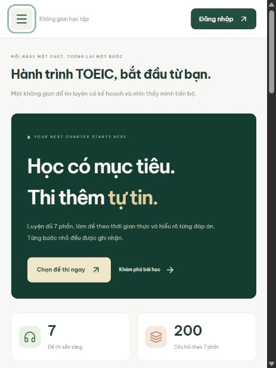
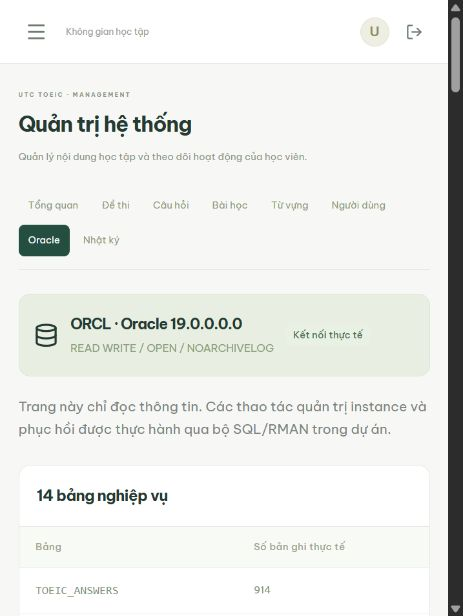

# Web UTC TOEIC - Luyện thi TOEIC cho SV GTVT, BTL môn CSDL Oracle

## Giới thiệu dự án

UTC TOEIC là website ôn luyện TOEIC dành cho sinh viên Trường Đại học Giao thông vận tải, được xây dựng cho bài tập lớn môn Cơ sở dữ liệu Oracle. Website kết hợp luyện đề, xem lại đáp án, học kiến thức theo từng Part và ôn từ vựng trong cùng một hệ thống.

Dự án sử dụng React cho giao diện, ASP.NET Core cho API và Oracle Database làm nơi lưu trữ dữ liệu. Oracle quản lý tài khoản, ngân hàng câu hỏi, đề thi, lượt làm bài, kết quả và học liệu; package PL/SQL đảm nhiệm tạo lượt thi và chấm điểm.

Dữ liệu mẫu gồm **200 câu hỏi thuộc đủ 7 Part**, **7 đề luyện tập**, **7 bài học** và **45 từ vựng**. Audio và hình ảnh được lưu cùng dự án để phục vụ các phần nghe và mô tả tranh.

## Công nghệ và kiến trúc

| Thành phần | Công nghệ | Vai trò |
| --- | --- | --- |
| Giao diện | React 19, Vite, React Router | Hiển thị nội dung, điều hướng, làm bài và quản trị |
| Dịch vụ web | ASP.NET Core 10 | Xác thực, phân quyền, kiểm tra dữ liệu và cung cấp API |
| Kết nối CSDL | ODP.NET Core | Thực thi SQL có tham số và quản lý giao dịch Oracle |
| Cơ sở dữ liệu | Oracle Database 19c, SQL, PL/SQL | Lưu trữ, ràng buộc dữ liệu, tạo lượt thi, chấm điểm và ghi nhật ký |

Luồng xử lý chính: **React → ASP.NET Core API → Oracle Database**. Thời hạn làm bài và điểm số được xử lý trên máy chủ. Mật khẩu được băm; API kiểm tra quyền của tài khoản trước khi đọc hoặc thay đổi dữ liệu.

## Cấu trúc dự án

```text
BTL_Oracle_UTC_Toeic/
├── web/                              # Giao diện React
│   ├── src/
│   │   ├── main.jsx                  # Khai báo các trang và tuyến điều hướng
│   │   ├── ui.jsx                    # Bố cục, phiên đăng nhập, thông báo, thành phần chung
│   │   ├── pages.jsx                 # Trang chủ, danh mục đề, học liệu, hồ sơ, lịch sử
│   │   ├── session.jsx               # Làm bài, lưu đáp án và xem kết quả
│   │   ├── admin.jsx                 # Giao diện quản trị nội dung và người dùng
│   │   ├── api.js                    # Gọi API và gửi token CSRF
│   │   └── styles.css                # Giao diện và bố cục theo kích thước màn hình
│   ├── index.html
│   └── vite.config.js
├── server/
│   ├── Toeic.Api/                    # Backend ASP.NET Core
│   │   ├── Program.cs                # Cấu hình API, xác thực, phân quyền và xử lý lỗi
│   │   ├── Store.cs                  # Kết nối Oracle, tham số SQL và giao dịch
│   │   ├── AuthEndpoints.cs          # Đăng ký, đăng nhập, hồ sơ và mật khẩu
│   │   ├── LearningEndpoints.cs      # Đề thi, lượt thi, kết quả và nội dung học
│   │   ├── AdminEndpoints.cs         # CRUD quản trị, tài khoản, media và metadata Oracle
│   │   ├── Seed.cs                   # Tạo dữ liệu và tài khoản mẫu
│   │   └── wwwroot/media/            # Audio MP3 và hình ảnh của đề thi
│   └── SeedData/content.json         # Ngân hàng câu hỏi, cấu trúc đề và học liệu
├── database/
│   ├── 01_schema.sql                 # 14 bảng, khóa, ràng buộc, index, view và trigger
│   ├── 02_packages.sql               # Package PL/SQL tạo lượt thi và chấm điểm
│   ├── 10_queries.sql                # 20 truy vấn phục vụ yêu cầu bài tập lớn
│   └── admin/                        # Instance, tablespace, user, role, Data Pump và RMAN
├── scripts/                          # Công cụ thiết lập, đóng gói, kiểm chứng và tạo báo cáo
├── tests/api.test.mjs                 # Kiểm thử tích hợp API với Oracle
├── docs/                             # Báo cáo, đối chiếu yêu cầu và minh chứng kiểm thử
│   └── screenshots/                  # Ảnh giao diện học viên và quản trị
├── De Thi Oracle UTC_CQ 2026.pdf      # Đề bài và yêu cầu bài tập lớn
└── README.md
```

Cấu hình kết nối riêng của từng máy, mật khẩu Oracle, bản sao lưu CSDL, thư viện cài đặt và tệp build được loại khỏi Git.

## Tài khoản mẫu

| Tên đăng nhập | Mật khẩu | Vai trò | Chức năng sử dụng |
| --- | --- | --- | --- |
| `student` | `Student@2026` | Học viên | Làm bài, xem kết quả, học bài, lưu từ vựng và quản lý hồ sơ |
| `admin` | `Admin@2026` | Quản trị viên | Quản lý nội dung, tài khoản, xem thống kê, nhật ký và thông tin Oracle |
| `editor` | `Student@2026` | Biên tập viên | Quản lý đề thi, câu hỏi, bài học, từ vựng và xem thống kê |
| `teacher` | `Student@2026` | Giảng viên | Xem thống kê và kết quả hoạt động học tập trong mục quản trị |
| `auditor` | `Student@2026` | Kiểm toán viên | Xem thống kê trong mục quản trị |

Các tài khoản học viên bổ sung gồm `linh`, `nam`, `ha`, `duc`, `trang`, cùng mật khẩu `Student@2026`. Tài khoản đăng ký mới luôn có vai trò học viên. Các tài khoản và kết quả có sẵn phục vụ minh họa chức năng của bài tập lớn.

## Hướng dẫn sử dụng dành cho học viên

### Đăng ký và đăng nhập

Chọn **Đăng nhập** ở đầu trang. Người chưa có tài khoản chọn **Đăng ký ngay**, nhập họ tên, tên đăng nhập, email và mật khẩu. Sau khi đăng nhập, hệ thống hiển thị thông tin cá nhân và tiến độ học tập.

### Xem tổng quan và chọn đề

Trang **Tổng quan** hiển thị số bài đã hoàn thành, điểm tốt nhất, thời gian luyện tập và mục tiêu điểm của tài khoản. Vào **Thư viện đề thi** để tìm theo tên và lọc loại đề. Chọn một đề để xem mô tả, thời lượng, số câu và cấu trúc các Part trước khi làm bài.

Có thể chọn Full Test 200 câu, Mini Test hoặc các bộ luyện Listening, Reading và từng phần. Những đề ngắn phù hợp để ôn theo kỹ năng hoặc luyện trong thời gian giới hạn.

### Làm bài thi

1. Mở chi tiết đề và chọn bắt đầu làm bài. Nếu có lượt đang làm, hệ thống cho tiếp tục lượt đó.
2. Nghe audio, xem hình hoặc đọc đoạn văn, sau đó chọn đáp án cho từng câu.
3. Dùng nút trước/sau hoặc bảng số câu để di chuyển; đánh dấu những câu cần xem lại.
4. Theo dõi trạng thái lưu đáp án. Lựa chọn và câu đánh dấu được lưu để tiếp tục khi tải lại trang.
5. Kiểm tra các câu còn trống rồi nộp bài và xác nhận. Hết thời hạn, hệ thống kết thúc lượt theo thời gian trên máy chủ.

### Xem kết quả và lịch sử

Sau khi nộp, trang kết quả hiển thị điểm Listening, Reading, số câu đúng và thống kê theo Part. Người học có thể lọc câu sai, đối chiếu đáp án đã chọn với đáp án đúng và đọc phần giải thích hoặc transcript đi kèm.

Vào **Lịch sử làm bài** để mở lại kết quả các lượt trước. Nội dung câu hỏi được lưu theo từng lượt, giúp kết quả cũ vẫn giữ nguyên khi ngân hàng câu hỏi được chỉnh sửa.

### Học kiến thức và ôn từ vựng

Trong **Góc học tập**, chọn bài học theo Part để xem kiến thức, cách làm và lưu ý khi luyện đề.

Trong **Sổ tay từ vựng**, tìm theo từ hoặc nghĩa, lọc theo chủ đề, ẩn nghĩa để tự kiểm tra và lưu từ cần ôn. Chuyển sang danh sách từ đã lưu để học lại; có thể bỏ lưu khi không còn cần thiết.

### Quản lý tài khoản

Mở **Tài khoản của tôi** để cập nhật họ tên, điểm mục tiêu hoặc đổi mật khẩu. Dùng nút đăng xuất ở đầu trang khi kết thúc phiên sử dụng.

## Hướng dẫn sử dụng dành cho quản trị

Sau khi đăng nhập bằng tài khoản có quyền, chọn **Quản trị hệ thống** trong menu. Các mục hiển thị phụ thuộc vai trò của tài khoản.

### Quản lý đề thi

Trong mục **Đề thi**, chọn **Tạo đề mới**, nhập tên, mô tả, loại đề và thời lượng; chọn các câu hỏi thuộc ngân hàng rồi lưu. Đề có các trạng thái nháp, công khai và lưu trữ.

Khi xuất bản, cần chọn đầy đủ các câu thuộc cùng nhóm bài nghe hoặc bài đọc. Full Test phải đủ 200 câu theo cấu trúc 7 Part. Muốn sửa câu đang thuộc đề công khai, chuyển các đề liên quan về nháp trước. Đề đã có lượt làm được lưu trữ khi xóa để giữ lịch sử.

### Quản lý câu hỏi và tư liệu

Trong mục **Câu hỏi**, tìm nội dung hoặc lọc Part để thêm, sửa và quản lý câu hỏi. Nhập nội dung, các lựa chọn, đáp án đúng, độ khó và giải thích. Part 2 có ba lựa chọn; các Part còn lại có bốn lựa chọn.

Câu hỏi có thể thuộc nhóm dùng chung đoạn văn, audio hoặc hình ảnh. Chọn đúng nhóm khi thêm câu để giữ ngữ cảnh bài nghe và bài đọc. Có thể tải lên audio MP3/WAV và ảnh PNG/JPG/WEBP, tối đa 20 MB mỗi tệp. Hệ thống kiểm tra định dạng và nội dung nhận diện của tệp.

### Quản lý bài học và từ vựng

Mục **Bài học** cho phép thêm, sửa và xóa nội dung theo Part, gồm tiêu đề, tóm tắt, nội dung và thời lượng học. Mục **Từ vựng** quản lý từ, phiên âm, nghĩa, ví dụ và chủ đề. Nội dung sau khi lưu được hiển thị ở các trang học tương ứng.

### Quản lý người dùng và theo dõi hệ thống

Quản trị viên sử dụng mục **Người dùng** để cập nhật thông tin, đổi vai trò hoặc khóa/mở tài khoản. Tài khoản đang sử dụng không được tự khóa hoặc tự hạ quyền quản trị.

**Tổng quan** cung cấp số lượng tài khoản, đề, câu hỏi và các lượt hoàn thành. **Nhật ký** hiển thị các thao tác được ghi nhận. Mục **Oracle** hiển thị trạng thái kết nối, số dòng thực tế của 14 bảng, datafile, segment, extent và quyền ứng dụng. Màn hình này chỉ đọc thông tin; các thao tác quản trị CSDL được tách thành bộ SQL/RMAN trong `database/admin/`.

## Nội dung cơ sở dữ liệu Oracle

| Nhóm dữ liệu | Các bảng |
| --- | --- |
| Tài khoản và vai trò | `TOEIC_USERS`, `TOEIC_ROLES` |
| Ngân hàng câu hỏi | `TOEIC_GROUPS`, `TOEIC_QUESTIONS`, `TOEIC_CHOICES` |
| Đề thi và cấu trúc | `TOEIC_EXAMS`, `TOEIC_EXAM_ITEMS` |
| Lượt thi và câu trả lời | `TOEIC_ATTEMPTS`, `TOEIC_ANSWERS` |
| Học liệu | `TOEIC_LESSONS`, `TOEIC_VOCABULARY`, `TOEIC_SAVED_WORDS` |
| Nhật ký và quy đổi điểm | `TOEIC_AUDIT`, `TOEIC_SCORE_SCALE` |

Thiết kế sử dụng khóa chính, khóa ngoại, UNIQUE, CHECK và index để kiểm soát tính toàn vẹn. View tổng hợp dữ liệu đề và tiến độ; trigger ghi nhật ký thay đổi nội dung; package `PKG_TOEIC` xử lý lượt thi và chấm điểm trong giao dịch. Tài khoản kết nối của website là `TOEIC_APP`, sử dụng role `TOEIC_RUNTIME` với quyền trên các đối tượng được cấp.

Phần bài tập lớn có 20 truy vấn SQL cùng các kịch bản quản trị instance, tablespace, datafile, segment, extent, user, role, profile, sao lưu và phục hồi. Báo cáo, [bảng đối chiếu yêu cầu](docs/rubric.md) và kết quả kiểm chứng được lưu trong `docs/`.

## Phạm vi dữ liệu và kiểm chứng

- Bảy đề luyện tập sử dụng chung ngân hàng 200 câu, chưa phải bảy bộ đề độc lập.
- Điểm quy đổi phục vụ tự luyện, không phải điểm hoặc chứng chỉ chính thức của ETS.
- Bộ kiểm thử đã đạt 23/23 ca nghiệp vụ trên API kết nối Oracle thật; 20 truy vấn SQL đã thực thi và 14 bảng đều có ít nhất năm dòng tại thời điểm kiểm tra.
- Đã kiểm chứng Data Pump export/import schema và các thao tác tablespace, datafile, user, role, profile trong sandbox riêng.
- Các lệnh shutdown, chuyển chế độ instance và backup/restore vật lý bằng RMAN được cung cấp dưới dạng kịch bản, chưa thực thi trên ORCL dùng chung.

## Một số giao diện

<p>
  
  
</p>
